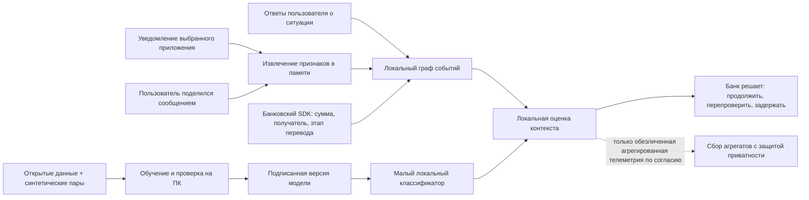

# ContextShield: подробный технический план MVP

**Дата проверки источников: 17 ноября 2026 года.** План опирается на концептуальный документ «Contextual Anti-Fraud SDK» от 28 октября 2026 года и текущий Kotlin-прототип. В исходном документе отдельно сказано, что проблема, доступность контекста, эффективность и экономика ещё требуют проверки. Поэтому ниже перечислены проектные решения и критерии проверки, а не обещания готовой точности.

## 1. Что именно строим

Цель MVP — банковский SDK/модуль, который перед подтверждением перевода собирает **узкий, заранее раскрытый пользователю контекст**, строит локальную временную картину давления и передаёт банковскому приложению оценку **риска конкретной операции**. Модуль не определяет «внушаемость» человека и не создаёт постоянный рейтинг личности.

Практический продукт состоит из четырёх частей:

1. **Android SDK для приложения банка:** получает от банка контекст создаваемого перевода и возвращает риск до подтверждения.
2. **Локальный сбор контекста коммуникаций:** уведомления выбранных пользователем приложений, плюс действие «проверить сообщение» через системную кнопку «Поделиться».
3. **Локальный граф событий:** объединяет признаки сообщений, добровольные ответы пользователя и события текущего банковского сценария по времени.
4. **Компактный классификатор на устройстве:** анализирует текст локально. Большая LLM не запускается на каждом уведомлении и не получает переписку.

На первом этапе поддерживаем Android. Windows делаем отдельным адаптером для локальных уведомлений и тестовым приложением; настоящую кнопку перевода на Windows можно встроить только в само банковское приложение или в его официальный веб/десктоп-клиент. Универсальный перехват чужого банковского интерфейса не является надёжной интеграцией.

## 2. Предлагаемая схема

Сырые уведомления не записываются в БД, не отправляются облаку и не логируются. Классификатор отдаёт вероятности/сигналы; граф связывает их с платежом. В банковское приложение передаются только объяснимые факторы и оценка, например: `срочность + просьба о переводе + легенда об операции`, а не полный текст сообщения.

## 3. Сигналы: что собирать и в каком порядке

Запрос «собрать как можно больше» конфликтует с приватностью и правилами платформ. Практический приоритет — **собирать разнообразные и добавляющие ценность сигналы**, а не максимальный объём личной информации.

| Приоритет | Источник | Что именно берём | Как ограничиваем | Оценка |
|---|---|---|---|---|
| P0 | Контекст перевода внутри банковского приложения | Сумма в диапазоне, новый/известный получатель, тип платежа, этапы самого банковского сценария, попытки изменить реквизиты | Банк уже знает транзакцию; SDK получает только необходимые признаки и держит их в памяти до решения | Самый надёжный канал для реального блокирующего решения |
| P0 | Уведомления выбранных мессенджеров | Доступные Android title/text/BigText/MessagingStyle, приложение-источник | Отдельное понятное включение доступа, список исключений/разрешённых приложений в интерфейсе SDK, анализ только в памяти, кнопка паузы и очистки | Реализуемо на Android, но текст зависит от настроек приватности, формата уведомления, OEM и приложения |
| P0 | Пользователь сам делится сообщением | Только текст/ссылку, явно переданные через Android Sharesheet в ContextShield или SDK | Одноразовое действие пользователя; анализ локально; не сохранять исходный текст | Добавляет сообщения без фонового чтения чатов |
| P0 | Короткий добровольный опрос перед платежом | «Вас торопят?», «Просят держать разговор в тайне?», «Кто-то диктует получателя/код?», «Вы сами связались с человеком по известному номеру?» | 1–3 вопроса только при повышенном риске; ответы привязаны к операции, не к профилю личности | Дешёвый и приватный способ закрыть пробелы уведомлений |
| P1 | События непосредственно в банковском flow | Пользователь только что перешёл в перевод после просмотра предупреждения SDK; отменил/изменил получателя; разблокировал новый лимит | Банк формирует событие внутри своего приложения; никакого слежения за другими экранами | Полезный контекст только при интеграции с банком |
| P1, отдельно разрешить | Android UsageStats | Только признак вроде «мессенджер был на переднем плане за последние N минут», без истории пакетов на сервере | Требует специального разрешения из настроек и отдельного объяснения. Не нужен для первого релиза; на устройстве сразу свести к бинарному/категориальному признаку и удалить исходные события | Возможный контекст, но широкий доступ к поведению и повышенный policy/privacy риск |
| P1 | Windows UserNotificationListener | Windows-уведомления, которые доступны слушателю Windows | Пакетированное приложение, явный системный запрос разрешения, локальная фильтрация; пользователь отключает источник | Возможен для собственного Windows-клиента, но не гарантирует содержимое всех уведомлений/мессенджеров |
| P1 | Браузерный/Windows банковский интеграционный сигнал | Сумма, получатель и событие «создан перевод» из самого банка | Только официальный API банка/расширение с понятной целью и ограничением домена; не читать все вкладки | Правильный путь для банковского веб-клиента, требует партнёра |
| P2 | Ручной сигнал «я сейчас разговариваю с человеком, который инструктирует перевод» | Один факт самоотчёта для конкретной операции | Явная кнопка без записи звука/телефонного состояния | Низкая точность, но хороший приватный fallback |

**Не включать в сбор:** запись/распознавание телефонных разговоров, микрофон в фоне, клавиатурный ввод и кейлоггинг, буфер обмена в фоне, контакты/адресную книгу, постоянную геолокацию, фото/экран в фоне, скрытый Accessibility-парсинг чужих приложений, SMS/журнал вызовов без крайней необходимости и отдельного правового/policy-основания. Эти каналы либо чрезмерно вторгаются в частную жизнь, либо закрыты/ограничены платформой, либо не подходят для универсального распространения.

Android `NotificationListenerService` существует как системный API, но должен быть явно разрешён пользователем; доступность и содержание уведомления не гарантируются. `UsageStatsManager` требует отдельного специального доступа. Google Play ограничивает Accessibility API и требует раскрытия/согласия для чувствительного сбора. MediaProjection требует согласия пользователя на сессию и потому не является фоновым способом захвата сообщений. Эти ограничения подтверждают границы, уже отмеченные в документе проекта: [NotificationListenerService](https://developer.android.com/reference/android/service/notification/NotificationListenerService), [PACKAGE_USAGE_STATS](https://developer.android.com/reference/android/Manifest.permission#PACKAGE_USAGE_STATS), [политика Accessibility API](https://support.google.com/googleplay/android-developer/answer/10964491), [MediaProjection](https://developer.android.com/media/grow/media-projection).

Для Windows `UserNotificationListener` требует системного разрешения через `RequestAccessAsync`; применять его нужно как отдельный Windows-адаптер и проверить на целевых версиях Windows: [Microsoft Learn: UserNotificationListener](https://learn.microsoft.com/en-us/uwp/api/windows.ui.notifications.management.usernotificationlistener).

## 4. Контекстный граф пользователя — ядро системы

Граф должен быть **локальной временной историей событий вокруг перевода**, а не социальным графом контактов и не долговременным профилем уязвимости человека.

### 4.1 Типы узлов

- `MessageSignal`: локальный результат анализа сообщения: категории давления, класс сообщения, уверенность модели, время с точностью до интервала, источник как локальная категория (`messenger_A`), без текста, номера, URL, имени и ID чата.
- `UserAssertion`: явный ответ пользователя для этой операции, например «меня торопят» или «проверил по сохранённому номеру».
- `PaymentIntent`: событие от банковского SDK: диапазон суммы, новый/известный получатель как признак банка, тип/этап операции. Номер карты/счёта не копируется в ContextShield.
- `DeviceContext`: только локально рассчитанный категориальный сигнал (опционально: мессенджер был открыт недавно; экран/демонстрация экрана пользователь подтвердил вручную).
- `Intervention`: что показал банк и что выбрал пользователь — продолжил, отменил, сделал паузу, подтвердил проверку.

### 4.2 Типы связей

- `BEFORE_WITHIN`: событие произошло за несколько минут до платежа.
- `SAME_WINDOW`: несколько сигналов вошли в одно ограниченное окно, например 30 минут.
- `SUPPORTS`: разные признаки поддерживают общую тактику (срочность + секретность + перевод).
- `CONTRADICTS`: добровольная проверка по известному каналу или сигнал безопасного сценария снижает неопределённость.
- `RELATED_TO_PAYMENT`: только прямое связывание сигнала с текущей платежной попыткой в интегрированном банковском flow.

Каждая связь имеет `time_bucket`, confidence, TTL и происхождение. Не сохраняются персистентные идентификаторы собеседника или общий ID устройства для облака.

### 4.3 Обработка графа

1. Notification listener извлекает ограниченную строку и сразу вызывает локальный классификатор.
2. После оценки исходный текст уничтожается; в локальное хранилище попадает только компактный узел-сигнал.
3. Перед переводом банковский SDK добавляет `PaymentIntent` и просит граф собрать только релевантное окно событий.
4. Простой и объяснимый алгоритм объединяет признаки: максимальный риск одного события, сумму независимых тактик, давность, повторяемость, а также контрсигналы.
5. Считается риск **операции**: `transaction risk + communication context + sequence evidence`. Само наличие нескольких безобидных просьб о переводе не должно автоматически накапливать блокировку.
6. Банк получает JSON: общий риск, факторы, давность, качество покрытия/уверенность, рекомендуемое действие и версию модели. Сырые узлы остаются на устройстве.

Для MVP не нужна графовая нейросеть. Нужен локальный event store с типизированными узлами/рёбрами и прозрачная агрегация по времени. Маленький, разреженный набор наблюдений не оправдывает сложную GNN; она может красиво выглядеть, но не исправит отсутствующие/ложные данные. Графовая визуализация показывает цепочку «сигнал → временная близость → платеж → мера», а не имя/характер человека.

### 4.4 Хранение

- Сырые сообщения: только память процесса, уничтожать сразу после вывода локальных признаков.
- Детальные графовые узлы: короткий TTL (например, 24–72 часа по умолчанию) для проверки инцидента/демо; пользователь может очистить в один тап.
- Сводка по операции: локально до завершения или отмены платежа; при необходимости журнал для банка остаётся в его собственной системе по его политике.
- Старые личные сигналы не превращать в постоянный «скоринг пользователя». Если продукту нужна длинная агрегированная история, это отдельная цель обработки и отдельное согласование.
- Шифровать локальную БД ключом Android Keystore; файл не класть во внешнюю память и исключить из резервной копии. Android Keystore предназначен для изоляции ключевого материала: [Android Keystore](https://developer.android.com/privacy-and-security/keystore). Room даёт удобный слой над SQLite для event store: [Room](https://developer.android.com/training/data-storage/room).

## 5. Модель: обучить на открытых данных, запускать компактно

### 5.1 Правильная роль LLM

LLM в смартфоне не должна читать каждое уведомление, строить постоянный профиль или принимать решение о доступе к деньгам. Генеративная модель тратит больше памяти/энергии, может уверенно ошибаться и не должна заменять банковский policy engine.

План:

- **На телефоне:** маленький multilingual/Russian encoder-classifier с INT8 весами, работающий на коротком тексте; плюс небольшой набор правил для редких жёстких признаков (код/пароль, удалённый доступ, секретность). Модель вызывается после дедупликации и только на достаточно содержательном уведомлении.
- **На ПК при обучении:** сильная teacher LLM/классификатор размечает контрфактические пары и сложные примеры; каждую метку проверяют люди, автоматические метки не считаются эталоном.
- **Не на телефоне постоянно:** большая LLM может оставаться факультативным генератором пояснения лишь на странице конкретного кейса, если выбран локальный вариант и устройство справляется. Для MVP достаточно шаблона по факторам и не нужен отдельный генератор.
- **Облако:** не отправлять текст в OpenRouter или другой публичный inference API для производственного решения. Отправка обезличенных признаков всё равно может быть обработкой чувствительных/связываемых данных. Облачный LLM может быть инструментом разработки на открытых/синтетических примерах, не на живых уведомлениях.

### 5.2 Начальная модель и дистилляция

На Hugging Face найден мультиязычный классификатор Horizon-Labs/Phishing-Scam-Detector-Base: Apache-2.0, 307M параметров и 37 языков, включая русский. Его карточка показывает INT8 ONNX размером около 641 MB. Это **полезный baseline/teacher для ПК**, но слишком тяжёлый как первая модель в APK. Его собственные тесты включают реальные smishing-наборы на других языках и машинный перевод SMS на русский; это не доказывает качество на русских сообщениях мессенджеров и переводах между родственниками. См. [карточку модели и её ограничения/размер](https://huggingface.co/Horizon-Labs/phishing-scam-detector-base/blob/main/README.md).

Обучить student: начать с русскоязычного компактного encoder (например, RuBERT-tiny-подобный или multilingual MiniLM) и классификационной головы, сравнить 20M/50M/100M параметров, выбрать на метриках и реальном телефоне. Обучать multi-label, а не только `мошенник/не мошенник`:

- просьба о деньгах/переводе;
- давление временем/страхом;
- аварийная легенда (операция, авария, задержание);
- имитация банка/службы/родственника;
- просьба о секрете;
- просьба передать код, пароль, реквизиты;
- перевод на новый/«безопасный» счёт;
- удалённый доступ/демонстрация экрана;
- легитимная бытовая просьба/обычное уведомление;
- неопределённость/недостаточно контекста.

Модель должна возвращать категории и калиброванные оценки, а не придумывать историю. Отдельный graph scorer уже решает, сочетаются ли признаки с платежом.

### 5.3 Открытые наборы данных

- **FraudLens Russian v2.0:** карточка сообщает 6,327 размеченных русских сообщений и CC BY 4.0. Это хороший стартовый источник для таксономии банковских, телефонных и social-engineering сценариев, но корпус описан как собранный из публичных Telegram-каналов по антифроду; проверить исходную лицензию/права на тексты и возможные персональные данные до включения. Скорее всего, он содержит описания кейсов и примеры мошенничества, а не репрезентативные личные диалоги. [Dataset card](https://huggingface.co/datasets/Abdurohman/fraudlens-ru-v1).
- **Scam Shield SMS:** 20,261 английское сообщение, в карточке перечислены источники и CC BY 4.0; есть train/validation/test, а тест и validation составлены из реальных сообщений. Полезно для общих smishing-тактик и методики чистки, но язык английский; не переносить его score на русский чат. В карточке также перечислены слабые места разметки, которые надо учитывать. [Dataset card](https://huggingface.co/datasets/rasheq/scam-shield-sms).
- **dokster adaptation-scam RU/EN:** содержит русские примеры и синтетические/инструкционные данные. Использовать только как вспомогательный источник тестовых сценариев после проверки лицензии, синтетичности и качества; не считать ground truth для рабочих сообщений. [Dataset card](https://huggingface.co/datasets/dokster/adaption-scam-dataset-ru-en-v1).
- Дополнительно выбирать только датасеты с явно указанными лицензией, происхождением, разрешённым использованием и доступом к исходным условиям. Наличие карточки на Hugging Face само по себе не доказывает право переобучать и распространять полученную модель.

**Недостающий датасет:** легитимные русскоязычные сообщения близких, включая «переведи 10 рублей на проезд», с сопоставимыми опасными контрфактическими примерами («срочно тысячу долларов на операцию», «код из SMS», «никому не говори»). Публичного репрезентативного корпуса личной переписки, пригодного для банковского решения, в проверенных источниках не обнаружено. Создать собственный **синтетический открытый evaluation/training набор**: сценарии от людей по шаблонам, 2 независимых аннотатора, хранить только искусственные тексты, лицензировать CC BY 4.0/CC0 после проверки авторства.

### 5.4 Обучение и оценка

1. Зафиксировать карточки датасетов, версии, лицензии и SHA-256 исходных файлов.
2. Нормализовать текст; PII в публичных корпусах маскировать до тренировки; убрать точные и near-duplicate примеры.
3. Разбивать данные по источнику/кампании/шаблону и времени, а не случайно по строкам: иначе почти одинаковые тексты попадут одновременно в train и test.
4. Дополнить открытые positive примеры синтетическими и human-authored negative/counterfactual парами. Например, менять только один признак: срочность без денег; просьба о деньгах без давления; срочный перевод под легендой операции; просьба о коде; легитимная доставка/OTP.
5. Учить multi-label classifier; teacher soft labels использовать как дополнительный сигнал, но не принимать их вместо эталонных человеческих меток.
6. Калибровать пороги на отдельном русскоязычном наборе. «Просьба о переводе» не должна означать «мошенничество»; нужен контекст нескольких независимых тактик и/или платежа.
7. Для выпуска измерять recall при зафиксированном false-positive rate, precision-recall AUC, калибровку (Brier/ECE), coverage, долю «неизвестно», задержку, RAM, размер APK/модели и расход батареи. Давать метрики отдельно по каналам, источникам, версиям Android и видам сообщений.
8. Сравнить 3 системы на одном test: локальные правила, компактная модель, модель + граф. Граф должен показать добавочную ценность против текста одного сообщения.
9. Только после проверки on-device экспортировать в ONNX Runtime Mobile или LiteRT и сделать INT8 quantization; сравнить качество до/после quantization. Для Android есть официальные LiteRT инструменты и post-training quantization: [LiteRT](https://ai.google.dev/edge/litert) и [integer quantization](https://ai.google.dev/edge/litert/conversion/tensorflow/quantization/post_training_integer_quant).

**Рабочие целевые ограничения для эксперимента, не достигнутые результаты:** student-модель до 50–80 MB на диске; p95 инференса до 150 ms на среднем целевом Android; не более 150 MB дополнительной RAM при активном анализе. Если ограничения не выполняются — уменьшить/дистиллировать модель и сократить вызовы; не включать постоянно работающую LLM.

## 6. Облачная обработка без понимания «кто именно пользователь»

Нужно различать:

- **не отправлять прямой идентификатор** — убрать имя, телефон, email, реквизиты, chat ID, точный текст, точную временную метку;
- **псевдонимизацию** — облако всё ещё может связать записи и вывести особенности одного пользователя;
- **анонимизацию** — невозможно разумно связать данные с человеком. Это сложно гарантировать, особенно для временных последовательностей и редких комбинаций.

Поэтому первая версия не должна спрашивать облачную LLM «кто этот пользователь и его обманут ли?». Рекомендуемая cloud схема — **облако поставляет версионированный классификатор**, но inference на тексте и построение индивидуального графа идут на устройстве. Облако для обучения получает открытые данные и синтетические данные, не пользовательскую переписку.

Если банку нужна cloud часть в пилоте:

1. Передавать только агрегированные счётчики по большой группе: частота сочетаний тактик и качество решения; никакого текста/ID события.
2. Делать secure aggregation так, чтобы оператор не видел одиночную запись; добавлять differential privacy с параметрами, выбранными специалистом по privacy и опубликованными в DPIA/техспецификации.
3. Установить минимальный размер когорты и задержку публикации агрегатов; подавлять редкие комбинации и малые группы.
4. Не ставить постоянный installation ID и не отправлять точное время, приложение, адресата, сумму/счёт или IP в модельный сервис. Сетевой IP сам по себе может быть доступен инфраструктуре; не обещать полной анонимности.
5. Не отправлять персональные признаки провайдеру OpenRouter/Hugging Face Inference API. Если в будущем понадобится per-operation cloud inference, проводить отдельную оценку, раскрыть конкретный payload и получателей, получить отдельное согласие/правовое основание и держать модельный endpoint под контролем банка.
6. Модельные обновления подписывать, проверять hash и версию; приложение принимает только авторизованный артефакт. Не делать автообучение на пользовательских событиях.

Хеширование имени/номера не превращает его в анонимные данные, а псевдоним без имени всё ещё может быть персональными данными. GDPR прямо требует минимизации и privacy by design, но это не заменяет анализ юрисдикции/правового основания: [GDPR, Articles 5 and 25](https://eur-lex.europa.eu/eli/reg/2016/679/oj/eng/).

## 7. Приложение и стек бесплатных инструментов

**Android:** Kotlin + Android SDK, текущий `NotificationListenerService`, AndroidX Room для локального event store, Keystore для ключей, Kotlin Coroutines для in-process работы классификатора, ONNX Runtime Mobile или LiteRT для inference. Сервис уведомлений быстро вычисляет небольшие признаки; WorkManager — для надёжных отложенных задач, например загрузки подписанной модели/очистки, а не для синхронного решения перед платежом. Android описывает WorkManager как persistent scheduler, но не как универсальный немедленный путь: [Background work](https://developer.android.com/develop/background-work/background-tasks/persistent).

**Обучение:** Python, PyTorch, Hugging Face `datasets`/`transformers`, scikit-learn для базовых моделей/калибровки, Optimum/ONNX для экспорта, ноутбук/рабочая станция. Google Colab/Kaggle free GPU можно использовать для экспериментального обучения, но квоты и доступность бесплатных GPU меняются, поэтому план обучения должен работать и на CPU для маленького encoder. Hugging Face Hub можно использовать для публичных артефактов открытой модели, но это не закрытое хранилище пользовательских данных.

**Windows:** .NET/C# WinUI 3 или упакованное Win32 приложение с WinRT interop для разрешённого UserNotificationListener, плюс тот же ONNX classifier. Распространять MSIX/desktop installer подписанным пакетом; пользователь сам включает системный доступ. Для браузерного банка — интеграция у банка; никаких глобальных расширений, читающих каждую вкладку.

**Облако:** бесплатные инструменты подходят для разработки/обучения на открытых данных. Нельзя строить банковский production SLA или приватный обработчик уведомлений на «бесплатном лимите» API: лимиты, хранение, условия использования и доступность могут измениться. Production cloud inference — отдельная смета и security/privacy review; для MVP он не нужен.

## 8. UX разрешений и приватности

В приложении отдельная страница «Что защищаем и что читаем» до открытия системного диалога:

- показывать, что доступ к уведомлениям потенциально позволяет видеть их текст; назвать именно функцию и цель;
- отдельные переключатели источников; выключенный источник не читается;
- объяснить локальное удаление текста и хранение только категорий риска;
- состояние сервиса «работает / отключён / уведомлений без текста / обработано N»;
- «Пауза», «Удалить локальную историю», «Экспортировать мой граф», «Отключить доступ»;
- отдельно спросить opt-in для UsageStats, обучения/аналитики и любого облачного процесса; ни один consent не должен быть условием базовой защиты.

Доступ к уведомлениям широк по системной природе, поэтому фильтрация приложения внутри сервиса снижает обработку, но не устраняет факт предоставленного разрешения. Юрист банка/поставщика должен проверить правовые роли, уведомление, сроки, DPIA, Data Safety и канал Google Play до пилота.

## 9. Три этапа реализации и критерии готовности

### Этап 0 — зафиксировать сценарий (1 неделя)

- 8–12 экспертных интервью из исходного документа: fraud, мобильная платформа, privacy/security, продукт.
- Выбрать один главный сценарий: например, перевод под давлением лже-родственника или псевдобанка.
- Нарисовать политику порога: приложение выдаёт рекомендацию банку, а блокировку включает банк своим решением.
- Выход: утверждённый use case, threat model и перечень точных полей SDK.

### Этап 1 — Android source feasibility (1–2 недели)

- Проверить Android 12–16/17 target и несколько OEM, включая Xiaomi; приложение закрыто/перезапущено, скрытое содержимое уведомлений, длительные сообщения, групповые чаты, мессенджеры.
- Проверить `onListenerConnected`, переподключение после перезагрузки/обновления/смены разрешений, dedupe и отсутствие self-notification loop.
- Реализовать явное «Поделиться с ContextShield» и сверить покрытие с notification path.
- Зафиксировать долю уведомлений без текста, ошибку разбора, задержку и батарею.
- Выход: матрица поддержки по источникам и ОС; обещания продукта ограничены измеренной матрицей.

### Этап 2 — graph + classifier MVP (2–4 недели)

- Заменить SharedPreferences event JSON на Room schema из узлов/рёбер с TTL и миграциями.
- Реализовать локальный baseline, затем teacher/student classifier; включить пользовательский context check и bank demo transaction.
- В интерфейсе показывать цепочку, факторы, временное окно, confidence/unknown и источник данных.
- Протестировать пары «операция срочно» vs «10 рублей родственнику», код, реквизиты, remote access, срочность без денег, безопасные бытовые просьбы, обычный OTP/доставка.
- Выход: отчёт сравнения `rules → classifier → classifier + graph`, confusion matrix, FPR/recall/PR-AUC, результаты телефона.

### Этап 3 — пилотный SDK (после этапов 0–2)

- Разделить ядро (`ContextShieldCore`) и адаптеры источников (`AndroidNotificationSource`, `BankPaymentAdapter`, `ShareSheetSource`, позже Windows).
- Строго типизированный интерфейс, например `evaluate(PaymentIntent, LocalContextWindow): RiskAssessment`; сохранить backwards compatible versioning.
- Банку отдавать сигнал локально на устройстве; API на сервер — только если это одобрено банком и требуется его антифроду.
- Сделать shadow mode: считать решения, но не блокировать переводы; с банком сопоставить с подтверждёнными мошенническими кейсами.
- После shadow mode согласовать минимальное вмешательство: сначала pause/check/дополнительное подтверждение, не безусловная блокировка.
- Выход: независимый security/privacy review и доказательство прироста относительно baseline при заранее определённом пределе ложных срабатываний.

## 10. Технические и продуктовые метрики

- **Coverage до платежа:** доля целевых инцидентов, где контекст реально был доступен до подтверждения.
- **Добавочная ценность:** прирост recall/precision при том же FPR относительно антифрода банка и относительно уведомлений без графа.
- **False positive и friction:** доля легитимных переводов, которым показали задержку/предупреждение; отказ, жалоба, звонок поддержки.
- **Калибровка:** соответствуют ли группы риска реальным частотам инцидентов на независимой тестовой выборке.
- **Задержка:** локальный p50/p95 от уведомления до признаков; p50/p95 синхронного ответа SDK до разрешения продолжить flow.
- **Ресурсы:** размер модели, PSS/RAM, CPU, cold-start, энергопотребление за обычный день на нескольких классах устройств.
- **Privacy UX:** понимание пользователей; доля opt-in/отключений/очисток; какие разрешения дали и зачем.
- **Надёжность источников:** процент уведомлений без текста, поддержка Android/OEM/Windows, потеря событий, повторная доставка.
- Не использовать «деньги, остановленные кнопкой» как эквивалент предотвращённых потерь. Документ проекта правильно требует контроль/контрфактический анализ.

## 11. Решения, которые предлагаются зафиксировать

1. **Профиль личности не строим.** Строим короткий контекст вокруг транзакции.
2. **Никакая LLM не читает все уведомления и не видит полный пользовательский граф.** Маленький classifier работает локально; teacher LLM — только в offline-наборе разработки.
3. **Три MVP-канала:** уведомления с явным системным доступом; пользовательский Sharesheet; банк сам передаёт контекст своей операции. Четвёртый опциональный источник — UsageStats, только после policy/legal review.
4. **Windows не обещает универсальную банковскую интеграцию.** Он поддерживает notifications listener как отдельный consent-поток; платёжные события поступают только из банковского приложения/официального connector.
5. **Облако получает модель и агрегаты, не сообщения.** Если понадобится per-user cloud analysis — это новая privacy-архитектура, требующая отдельного согласования и раскрытия.
6. **Сейчас нет оснований обещать «точно определяет».** Критерий релиза — measured false-positive/coverage/recall на сценариях, не демонстрация нескольких удачных фраз.

## Проверенные источники

- Android notification listener: https://developer.android.com/reference/android/service/notification/NotificationListenerService
- Android `PACKAGE_USAGE_STATS`: https://developer.android.com/reference/android/Manifest.permission#PACKAGE_USAGE_STATS
- Google Play policy: https://support.google.com/googleplay/android-developer/answer/10964491
- Android MediaProjection: https://developer.android.com/media/grow/media-projection
- Windows notification listener: https://learn.microsoft.com/en-us/uwp/api/windows.ui.notifications.management.usernotificationlistener
- Android Keystore: https://developer.android.com/privacy-and-security/keystore
- Android Room: https://developer.android.com/training/data-storage/room
- Android WorkManager: https://developer.android.com/develop/background-work/background-tasks/persistent
- Google LiteRT / quantization: https://ai.google.dev/edge/litert и https://ai.google.dev/edge/litert/conversion/tensorflow/quantization/post_training_integer_quant
- Open Russian dataset, CC BY 4.0 as stated on card: https://huggingface.co/datasets/Abdurohman/fraudlens-ru-v1
- Open SMS dataset, CC BY 4.0 sources stated on card; English and known limitations: https://huggingface.co/datasets/rasheq/scam-shield-sms
- Auxiliary synthetic RU/EN dataset: https://huggingface.co/datasets/dokster/adaption-scam-dataset-ru-en-v1
- Multilingual 307M baseline, Apache-2.0, quantized artifact 641 MB and self-reported evaluation limitations: https://huggingface.co/Horizon-Labs/phishing-scam-detector-base/blob/main/README.md
- GDPR official text: https://eur-lex.europa.eu/eli/reg/2016/679/oj/eng/
